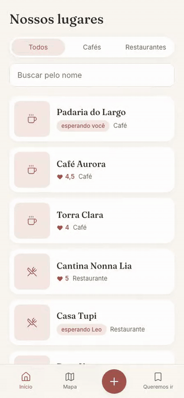
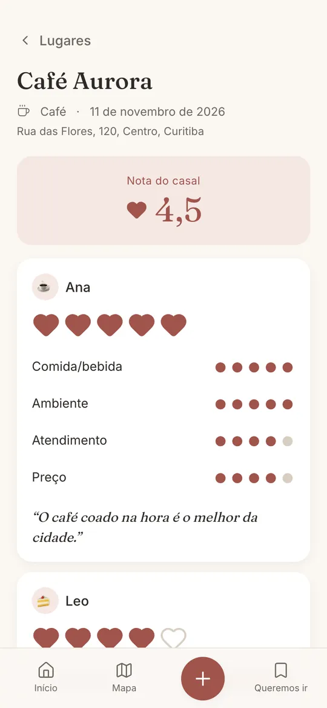
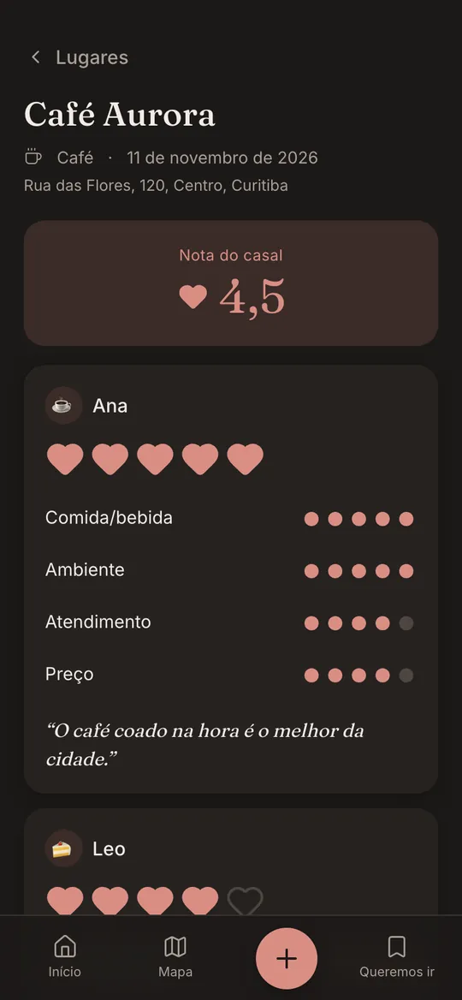
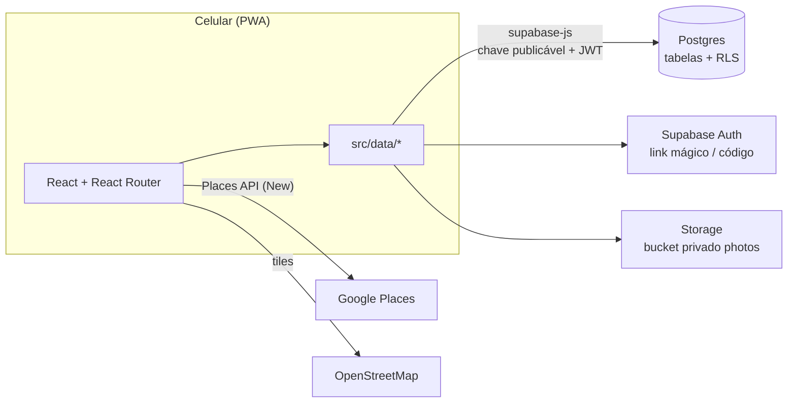
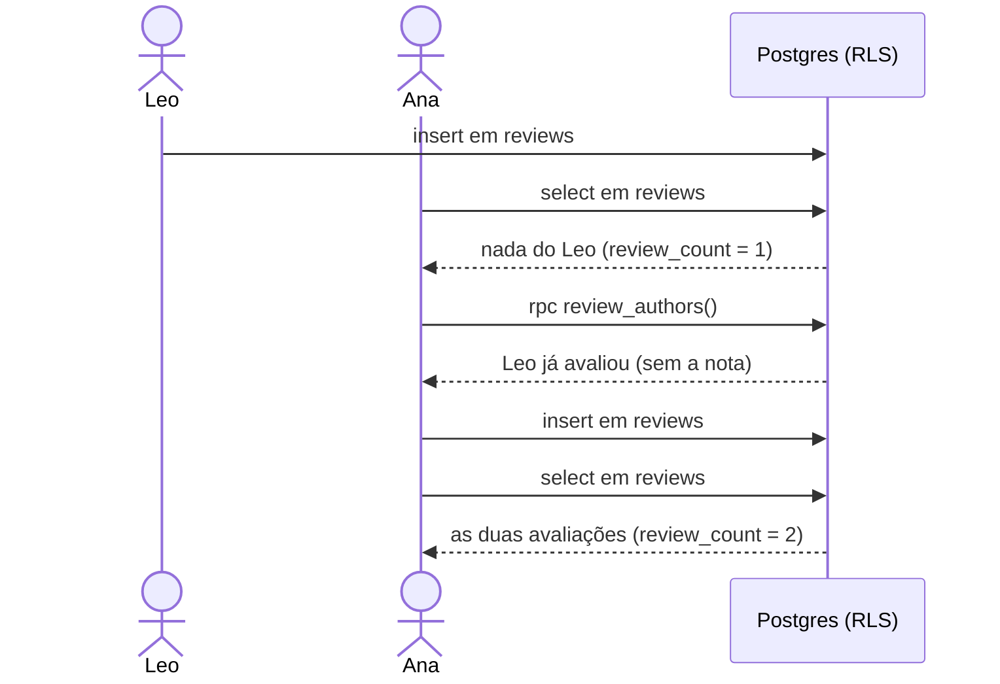

# TWS Score

PWA para um casal avaliar os cafés e restaurantes que visita junto. Cada pessoa avalia no próprio celular, e a nota do outro só aparece quando os dois terminam: a **nota surpresa**.

<p align="center">
  
</p>

<p align="center">
  
  &nbsp;
  
</p>

<sub>Dados fictícios. O app é de uso privado do casal, então não há link público.</sub>

## Funcionalidades

- Login por link mágico ou código de 6 dígitos, restrito aos dois membros.
- Nova visita em dois passos: o lugar (nome, tipo, localização, data) e a avaliação. O rascunho fica salvo no aparelho até o envio.
- Busca de lugares no Google: ao digitar o nome, escolher uma sugestão preenche tipo, endereço e localização e guarda nota, faixa de preço, horários, telefone e site do lugar.
- Avaliação com nota geral de 1 a 5 corações, quatro critérios (comida/bebida, ambiente, atendimento, preço), comentário e fotos.
- Nota surpresa: a avaliação do outro fica fechada até as duas existirem. Depois, aparece a nota do casal.
- Lista "Queremos ir", com atalho "Fomos!" que já abre a nova visita.
- Mapa com todos os lugares que têm localização.
- Instalável na tela inicial, com tema claro e escuro.

## Como funciona

Não há servidor próprio. O app é estático e fala direto com o Supabase; as regras de acesso ficam no Postgres, em políticas de RLS, e não na interface.



### A nota surpresa

A política de RLS de `reviews` só devolve uma avaliação a quem a escreveu, ou a qualquer membro quando o lugar já tem duas avaliações:

```sql
create policy reviews_select on public.reviews
  for select to authenticated using (
    public.is_member()
    and (autor_id = auth.uid() or public.review_count(place_id) = 2)
  );
```



Não existe política de `update` nem de `delete`, então uma avaliação enviada não muda mais. Os testes em `supabase/tests/` provam essas regras contra o banco real, dentro de uma transação desfeita no final.

O schema completo, o diagrama ER, todas as políticas e o mapa de funções do app para chamadas do Supabase estão em [docs/database.md](docs/database.md).

## Stack

- React 19, TypeScript, Vite, React Router
- Supabase: Auth (link mágico), Postgres com RLS, Storage
- Google Places API (New) para buscar lugares
- Leaflet com OpenStreetMap
- `vite-plugin-pwa`
- Vitest e Testing Library, oxlint, Prettier

## Rodando localmente

Pré-requisitos: Node 20 ou mais recente e um projeto Supabase.

1. Instale as dependências:

   ```bash
   npm install
   ```

2. Copie `.env.example` para `.env.local` e preencha:

   | Variável | Para que serve |
   |---|---|
   | `VITE_SUPABASE_URL` | URL do projeto, `https://<project-ref>.supabase.co` |
   | `VITE_SUPABASE_PUBLISHABLE_KEY` | Chave publicável (`sb_publishable_...`). Vai para o navegador; quem protege os dados é a RLS. |
   | `VITE_GOOGLE_MAPS_KEY` | Opcional. Sem ela, o nome do lugar é digitado à mão. Precisa da Places API (New) ativada e de restrição aos domínios do app. |

3. Aplique as migrações de `supabase/migrations/` em ordem, pelo SQL Editor ou pela Supabase CLI.

4. Crie as contas dos membros no Auth (Authentication > Users > Add user) e cadastre-os em `members`. Use `supabase/members.example.sql` como modelo. Deixe o cadastro de novos usuários desligado.

5. No painel do Supabase, em **Authentication > URL Configuration**, adicione `http://localhost:5173` às Redirect URLs.

6. Inicie o app:

   ```bash
   npm run dev
   ```

## API

O app não tem API própria nem edge functions: usa a API REST que o Supabase gera a partir do schema (PostgREST). [docs/database.md](docs/database.md#swagger-e-postman) explica como baixar o OpenAPI dessa API para abrir no Swagger ou importar no Postman.

## Scripts

| Comando | O que faz |
|---|---|
| `npm run dev` | Servidor de desenvolvimento |
| `npm test` | Testes unitários e de componentes |
| `npm run typecheck` | Checagem de tipos |
| `npm run lint` | Lint com oxlint |
| `npm run format` | Formata `src/` com Prettier |
| `npm run build` | Build de produção com service worker |
| `npm run preview` | Serve o build localmente |

## Testes

- `npm test` roda os testes de `src/` (lógica da nota surpresa, rascunho, horários, formulários e telas) com Vitest e Testing Library, sem precisar de Supabase.
- Para as regras de acesso, execute `supabase/tests/rls_test.sql` e `supabase/tests/storage_test.sql` no banco. Eles simulam os dois membros e um intruso e terminam com `rollback`, sem deixar dados.

## Deploy

O build é estático (`npm run build` gera `dist/`). O repositório está pronto para a Vercel: `vercel.json` reescreve todas as rotas para `index.html` por causa do React Router. Configure as três variáveis `VITE_*` no provedor e adicione o domínio de produção às Redirect URLs do Supabase e às restrições da chave do Google.

## Estrutura

```
src/
  auth/        login, sessão e acesso restrito
  components/  peças de interface reutilizadas (corações, pontinhos, navegação)
  data/        acesso ao Supabase; converte linhas do banco em tipos de domínio
  features/    lógica e componentes de cada tela
  lib/         tipos de domínio e lógica pura (nota surpresa, rascunho, imagem)
  pages/       telas
supabase/
  migrations/  schema, RLS e storage
  tests/       testes das regras de acesso
docs/
  database.md  schema, RLS e como o app usa o Supabase
```
