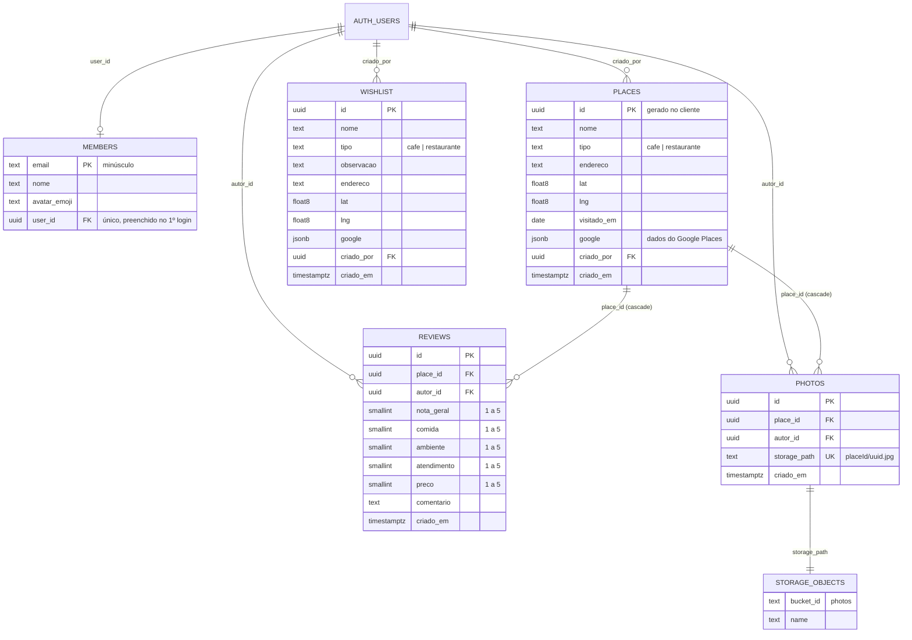

# Banco de dados

O TWS Score não tem servidor próprio nem edge functions. O navegador fala direto com o Supabase (Postgres, Auth e Storage) usando a chave publicável, e quem decide o que cada pessoa pode ler ou gravar são as políticas de RLS. Este documento descreve o schema de `supabase/migrations/`, as regras de acesso e onde o app chama cada coisa.

## Modelo de dados



| Tabela | Para que serve | Regras no schema |
|---|---|---|
| `members` | Lista fechada de quem pode usar o app (os dois do casal). Cadastrada à mão, ver `supabase/members.example.sql`. | `email` sempre minúsculo. `user_id` liga o e-mail à conta do Auth no primeiro login. |
| `places` | Um café ou restaurante visitado. | `tipo` só `cafe` ou `restaurante`; `lat` e `lng` vêm juntos ou nenhum. `google` guarda `placeId`, link do Maps, site, telefone, horários, faixa de preço e nota do Google. |
| `reviews` | A avaliação de uma pessoa sobre um lugar. | Notas de 1 a 5. `unique (place_id, autor_id)`: uma avaliação por pessoa por lugar, então no máximo duas por lugar. |
| `photos` | Metadados das fotos; o arquivo fica no bucket `photos`. | `storage_path` único. Apagar o lugar apaga as linhas (cascade). |
| `wishlist` | A lista "Queremos ir". | Mesmas regras de `tipo` e `lat`/`lng` de `places`, para o "Fomos!" já abrir a visita preenchida. |

O bucket `photos` é privado, aceita só `image/jpeg` e até 5 MB por arquivo. O app comprime as fotos no navegador antes de enviar (`src/lib/image.ts`) e as exibe por URLs assinadas que valem uma hora.

## Funções

Todas são `security definer` com `search_path` vazio, executáveis só por `authenticated` (o acesso de `anon` e `public` é revogado).

| Função | O que faz |
|---|---|
| `is_member()` | `true` se o e-mail do JWT está em `members`. Base de todas as políticas. |
| `claim_membership()` | Grava o `auth.uid()` em `members.user_id` para o e-mail logado. Idempotente; o app chama em todo login. |
| `review_count(place)` | Quantas avaliações o lugar tem, contando também as que o usuário não pode ver. |
| `review_authors()` | Pares `(place_id, autor_id)` de todas as avaliações, sem as notas. Alimenta os selos "esperando você" e "esperando Leo". |

`review_count` existe porque uma política de `reviews` não consegue contar linhas de `reviews`: a subconsulta passaria pelo mesmo filtro e nunca enxergaria a avaliação do outro.

## Regras de acesso (RLS)

Todas as tabelas têm RLS ligado. Quem não está logado não acessa nada. Quem está logado mas não está em `members` vê a tela de acesso restrito e o banco não devolve nem aceita nada.

| Tabela | Ler | Criar | Editar | Apagar |
|---|---|---|---|---|
| `members` | membros | ninguém (só pelo SQL Editor) | ninguém (só via `claim_membership`) | ninguém |
| `places` | membros | membros, como `criado_por = eu` | membros | membros |
| `reviews` | a própria; a do outro só quando o lugar tem duas | membros, como `autor_id = eu` | **ninguém** | **ninguém** |
| `photos` | membros | membros, como `autor_id = eu` | ninguém | membros |
| `wishlist` | membros | membros, como `criado_por = eu` | membros | membros |
| `storage.objects` (bucket `photos`) | membros | membros | ninguém | membros |

### A nota surpresa

É a regra central do app e vive inteira no banco:

```sql
create policy reviews_select on public.reviews
  for select to authenticated using (
    public.is_member()
    and (autor_id = auth.uid() or public.review_count(place_id) = 2)
  );
```

Na prática:

1. Ana avalia a Padaria do Largo. Ela lê a própria avaliação; Leo, ao consultar `reviews`, não recebe a linha dela.
2. Leo vê o selo "Ana já avaliou. Sua vez!" porque `review_authors()` diz quem avaliou, sem dizer a nota.
3. Leo avalia. Agora `review_count` dá 2 e os dois passam a receber as duas linhas: o app mostra as notas lado a lado e a média do casal.

Como não há política de `update` nem de `delete` em `reviews`, ninguém consegue trocar a nota depois de ver a do outro. Mesmo alguém chamando a API REST direto com o próprio token não contorna a regra, porque o filtro é aplicado pelo Postgres.

### Testes das regras

`supabase/tests/rls_test.sql` e `supabase/tests/storage_test.sql` simulam os dois membros e um intruso trocando `request.jwt.claims` e verificam, entre outros: a nota do outro escondida até as duas existirem, `review_authors` sem nota, avaliação travada para `update` e `delete`, `claim_membership` idempotente, não membro sem leitura nem escrita, e fotos do bucket só para membros. Cada arquivo roda numa transação que termina em `rollback`, então pode ser executado no SQL Editor sem deixar dados.

## Como o app chama o banco

Todo acesso passa por `src/data/`, que usa o cliente de `src/lib/supabase.ts` e converte as linhas em tipos de domínio (`src/data/rows.ts`).

| Função | Chamada ao Supabase | Usada em |
|---|---|---|
| `claimMembership()` (`data/members.ts`) | `rpc('claim_membership')` | `AuthGate`, após o login |
| `listMembers()` | `from('members').select('*')` | `AuthGate`, para saber quem é "eu" e quem é o par |
| `listPlaces()` / `getPlace(id)` (`data/places.ts`) | `from('places').select` | Início, Mapa, página do lugar |
| `createPlace(input)` | `from('places').upsert(..., { onConflict: 'id', ignoreDuplicates: true })` | Nova visita. O `id` é gerado no cliente e guardado no rascunho, então reenviar após uma falha não duplica o lugar. |
| `listVisibleReviews(placeId?)` (`data/reviews.ts`) | `from('reviews').select('*')` | Devolve só o que a RLS libera |
| `listReviewAuthors()` | `rpc('review_authors')` | Selos de status |
| `submitReview(...)` | `from('reviews').insert` | Nova visita. Violação de `unique` vira `'already_sent'` em vez de erro. |
| `uploadPhoto(placeId, blob)` (`data/photos.ts`) | `storage.from('photos').upload` + `from('photos').insert` | Nova visita e página do lugar |
| `listPhotoUrls(placeId?)` | `from('photos').select` + `storage.createSignedUrls` | Capas e galeria |
| `listWishes` / `getWish` / `addWish` / `removeWish` (`data/wishlist.ts`) | `from('wishlist')` | "Queremos ir" e o atalho "Fomos!" |

O login usa `supabase.auth.signInWithOtp` com `shouldCreateUser: false` (só contas já criadas recebem o link ou código) e `verifyOtp` para o código de 6 dígitos (`src/auth/LoginPage.tsx`).

A busca de lugares não passa pelo Supabase: `src/lib/google.ts` chama a Places API (New) do Google direto do navegador (`places:autocomplete` e detalhes do lugar), com a chave `VITE_GOOGLE_MAPS_KEY` restrita por domínio.

## Swagger e Postman

Não há API própria para documentar: o app usa o PostgREST que o Supabase gera a partir do schema. Quem quiser explorar essa API em Swagger ou importar no Postman pode baixar o OpenAPI gerado pelo próprio Supabase:

```bash
curl "https://<project-ref>.supabase.co/rest/v1/" \
  -H "apikey: <chave secreta do projeto>" > postgrest-openapi.json
```

A resposta é um documento OpenAPI 2.0 com as tabelas e funções do schema `public`; ele pode ser aberto no Swagger Editor ou importado no Postman (Import > arquivo). O Supabase pode recusar esse endpoint com a chave publicável, por isso o exemplo usa a chave secreta: rode o comando só na sua máquina e não versione a chave. Para chamar as tabelas, use a chave publicável em `apikey` e `Authorization: Bearer <access token de um membro>`; sem o token de um membro, a RLS não devolve linhas.
